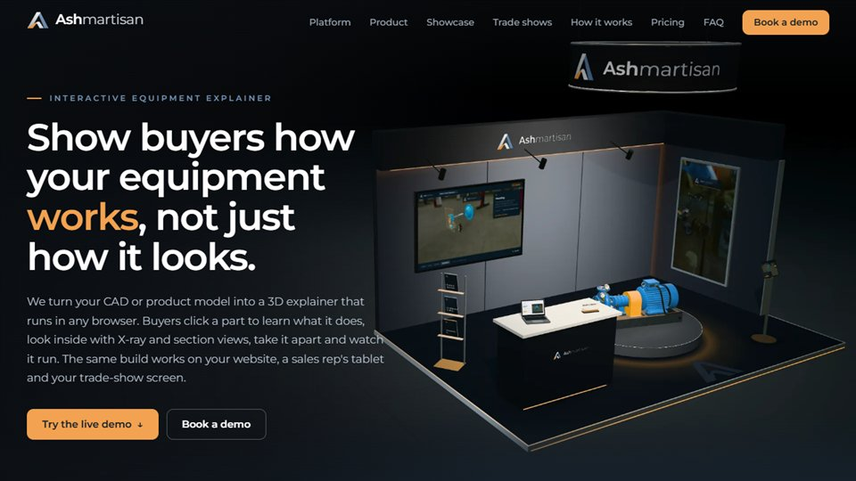
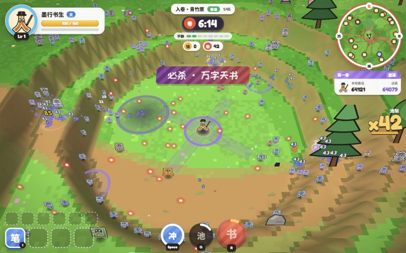
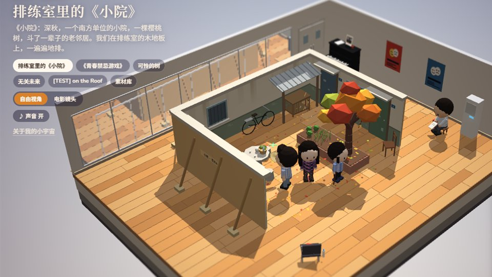
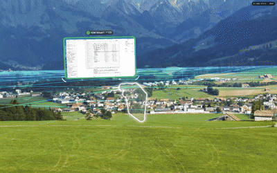
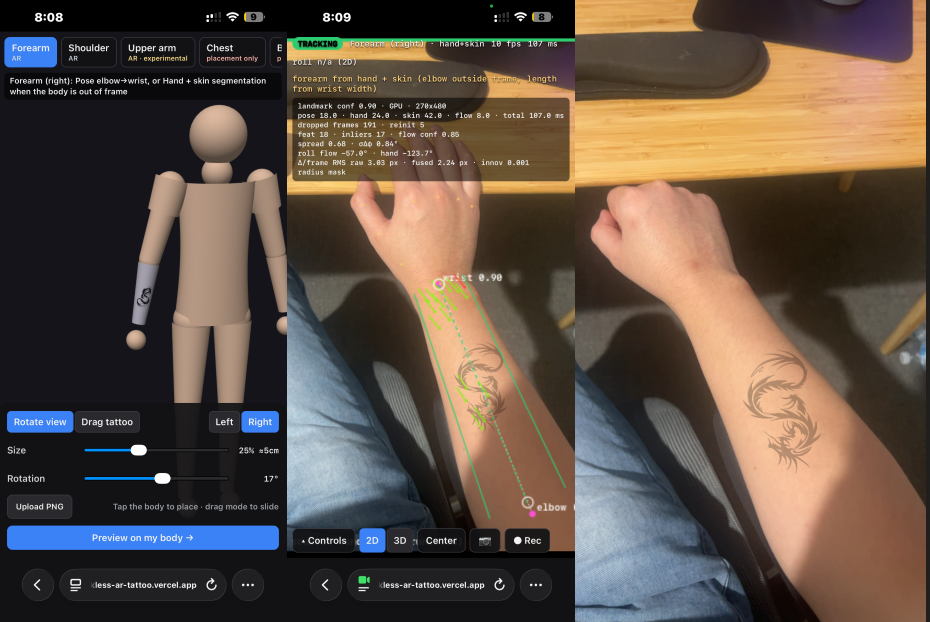

<a href="https://ashmartisan.com/blog/">
  <picture>
    <source media="(prefers-color-scheme: dark)" srcset="assets/hero-dark.svg">
    <source media="(prefers-color-scheme: light)" srcset="assets/hero-light.svg">
    
  </picture>
</a>

I'm a 3D graphics and WebGL engineer. I work on digital twins, interactive maps, shaders and browser games, and I care most about making 3D that runs well on the web without an install.

Right now I'm building [**Ashmartisan**](https://ashmartisan.com), which turns CAD models of industrial equipment into interactive 3D explainers.

## Selected work

<table>
  <tr>
    <td width="50%" valign="top">
      
      <h3><a href="https://ashmartisan.com">Ashmartisan</a></h3>
      Click a part to learn what it does, see inside with X-ray and section views, take the machine apart and watch it run. All in the browser.
        
      <code>Babylon.js</code> <code>Web 3D</code>
    </td>
    <td width="50%" valign="top">
      
      <h3><a href="https://hanzi-survivor.vercel.app/">Hanzi Hero 字海残卷</a></h3>
      A survivor-style action roguelite where your powers are Chinese characters. Pick up radicals, fuse them into hanzi, then grow those into words.
        
      <code>Babylon.js</code> <code>Browser game</code>
    </td>
  </tr>
  <tr>
    <td width="50%" valign="top">
      
      <h3><a href="https://friend-little-universe.vercel.app/">My Little Universe 我的小宇宙</a></h3>
      Real memories with friends rebuilt as tiny low-poly dioramas. Everyone lives on: they wander, chat, rehearse their lines and wave when you tap them.
        
      <code>Babylon.js</code> <code>Web Audio</code>
    </td>
    <td width="50%" valign="top">
      
      <h3><a href="https://github.com/zblcool/ar-glasses-spatial-space-manager">AR Glasses Spatial Space Manager</a></h3>
      A spatial desktop for macOS on VITURE glasses. Every display becomes a movable screen in a 360° panorama, and the camera follows your head.
        
      <code>three.js</code> <code>TypeScript</code>
    </td>
  </tr>
  <tr>
    <td colspan="2" valign="top">
      
      <h3>Markless AR Tattoo</h3>
      AR tattoos that need no marker draws on the body.
    </td>
    <td></td>
  </tr>
</table>

## Find me

[Portfolio and blog](https://ashmartisan.com/blog/) · [Ashmartisan](https://ashmartisan.com) · [LinkedIn](https://www.linkedin.com/company/ashmartisan-studio)
